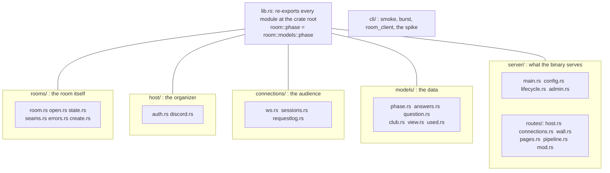

# ADR-0002: Group the room's source by who uses it

**Status:** Accepted (PR #66, draft until merged)
**Date:** 2026-10-12
**Deciders:** Michelle asked for the room grouped by function: host session with Discord and auth, audience socket management in one place, data models in another; later also server and CLI as groups
**Contract:** none changed. Routes, error strings, JSON shapes and the socket protocol are untouched.

## Context

`room/src` was one flat folder of 19 files plus `bin/`. A reviewer had to know
the build plan to find anything:

| File | Lines | Mixed together |
|---|---|---|
| `rooms.rs` | 1,266 on `main` | the room record, the app state, the create path, the error types, the sealed read, the session seam |
| `routes.rs` | 764 | the organizer's routes, the audience's routes, the wall's assets, the admin channel, six embedded pages |
| `bin/` | 5 clients | sat beside the server's own modules |

Discord sign-in, the audience's sockets and the data models had no visible
boundary, although the code already had one: `auth` and `discord` serve the
organizer, `ws`, `sessions` and `requestlog` serve the audience, and `phase`,
`answers`, `question`, `club`, `view` and `used` are data.

## Decision

Group the files by who uses them, and keep every module at its old crate path.

- **Whole-file moves.** Each commit in #66 is either a pure rename, a split
  whose code moves unchanged, or documentation. `git diff -M` shows the renames
  at 100% similarity.
- **Crate-root re-exports.** `lib.rs` has `pub use models::{answers, phase, ...}`
  and the like, so `room::phase` and `room::models::phase` are one module.
  No test and no binary changed an import. PR #64's `organizer-tui`, which
  depends on `room::answers`, still builds and passes on top of this branch.
- **`routes.rs` is split by user** into `server/routes/{host,connections,wall,pages,pipeline}.rs`.
  Each marker block (`// T-04b routes`, `// T-25 routes`, ...) moves whole and
  routes are registered in the same order. The socket layers stay last in
  `mod.rs`, as the comment there demands.
- **`rooms.rs` is split** into a `rooms/` folder (see ADR-0003 for why `open.rs`
  is its own file).
- **`bin/` becomes `cli/`**, and `main.rs`, `config.rs`, `lifecycle.rs`,
  `admin.rs` and the routes become `server/`. `Cargo.toml` names the paths.
- **Tests stay flat.** Cargo builds each file in `tests/` as its own target, so
  folders would change the 31 targets. `room/README.md` maps each test to a
  group instead.

## Options Considered

### Option A: Folders by user, re-exports at the root (chosen)

| Dimension | Assessment |
|---|---|
| Complexity | Low: moves and re-exports, no logic edited |
| Risk | Low: the same tests prove it; one scan class needed care (ADR-0004) |
| Reviewability | High: a pure-rename commit is a skim, not a read |

**Pros:** a reviewer finds the Discord code, the socket code and the data types
without a map; no import churn; revertable per commit.
**Cons:** two paths name each module (`room::ws` and `room::connections::ws`).

### Option B: Folders, and update every import to the new path

Cleaner names, but touches 28 test files and every bin, and breaks PR #64's
path dependency. **Rejected** for the churn; can be done later by deleting the
re-exports.

### Option C: A second crate for the shared types

The earlier plan in `/room-reorg/PLAN.md` offered `room-shared`. It changes the
Dockerfile, the lockfile and the `just` recipes, none of which can be built in a
cloud session (no Docker build). **Rejected**: Michelle chose a folder in the
same crate.

### Option D: Leave the flat layout and add a README map

Zero risk, but the 1,266-line and 764-line files stay. **Rejected.**

## Trade-off Analysis

The cost of grouping is paid in the guardrail tests, not the code: several read
source files by name (ADR-0004). The benefit is paid every review. Whole-file
moves with re-exports keep the cost to path edits and make the review cheap.

## Consequences

**Benefits**

| Before | After |
|---|---|
| Largest room file 1,266 lines | Largest is `rooms/state.rs`, 443 |
| `routes.rs` 764 lines for every user | Largest route file is `host.rs`, 238 |
| Find Discord code: read the module list | `host/` |
| Find the audience's socket code | `connections/` |
| Find the data types | `models/` |
| Server wiring and CLI clients beside each other | `server/` and `cli/` |
| Six concerns in one `rooms.rs` | six files, each named for one |
| A change to the admin routes is in a 764-line diff | it is in `routes/pipeline.rs` |

Review gets cheaper: every commit in #66 either renames files, moves code whole,
or documents; none rewrites logic. The tree and a test-to-group table are in the README's *Source layout*.

**Harder / accepted**
- Two paths name each module until the re-exports are dropped.
- `models/view.rs` (677 lines) is not split (ADR-0003).
- Fields that sibling files in `rooms/` read are `pub(super)`: still private to
  the `rooms` module, but now a keyword to read.
- Merging to `main` deploys to Fly and restarts the machine, as for any change.

**To revisit:** drop the root re-exports and use the long paths; group `tests/`
into folders if the target count ever matters; split `view.rs` if the seal test
is rewritten to read a folder.

## Action Items

1. [x] Move the files, re-export at the root, fix scan paths (PR #66)
2. [x] Split `routes.rs` and `rooms.rs`
3. [x] README *Source layout* and test-group table
4. [ ] Merge #66 when Michelle says "merge"; it deploys

## Where it lives

`room/src/{rooms,host,connections,models,server,cli}/` · `room/src/lib.rs` ·
`room/Cargo.toml` · `room/README.md` (*Source layout*)
