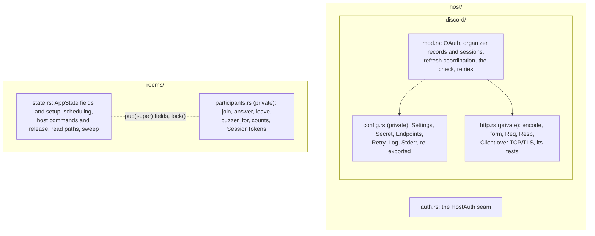
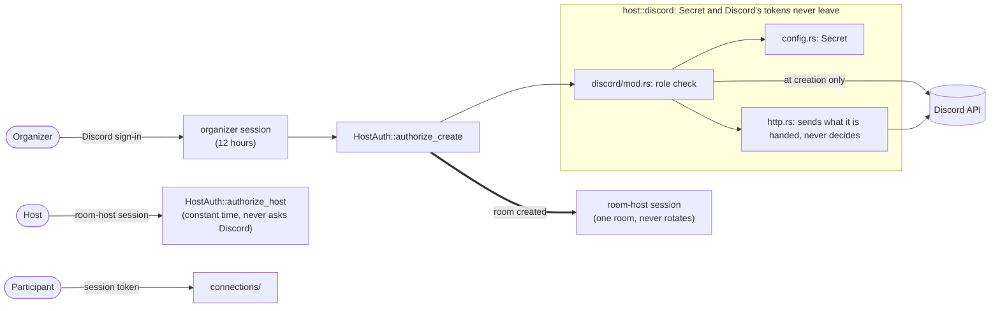
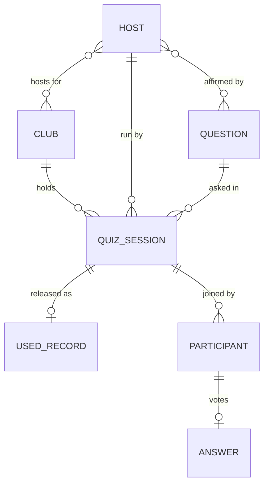

# ADR-0005: Separate the live room's responsibilities, keep one state owner

**Status:** Proposed (Michelle accepts or declines; a one-line commit flips it to Accepted before merge)
**Date:** 2026-10-12
**Deciders:** Michelle wrote the plan and the proposed MADR (Lattice PQ-71); Claude carried them out and chose the file-level details recorded here
**Contract:** none changed. Routes, payloads, error strings and their order, lock scopes and their order, public paths and method signatures are untouched. G-3, G-9, G-10, AC-61, AC-65, AC-66, AC-68, AC-69 hold as before.

Refines [ADR-0002](0002-group-the-room-source-by-who-uses-it.md) (group the room source by who uses it) one level down, inside `host/` and `rooms/`. Touches one [ADR-0004](0004-guardrail-scans-walk-the-tree.md) scan. Supersedes nothing.

## Context

After ADR-0002 the room's source was grouped by user, but two files still
mixed concerns:

| File | Lines on `main` | Mixed together |
|---|---|---|
| `host/discord.rs` | 1,019 | configuration and secrets, an HTTP/1.1 client over TCP or TLS, percent encoding, and the OAuth, session, refresh and authorization logic |
| `rooms/state.rs` | 486 | the state and its setup, scheduling, host commands and release, read paths, the sweep, and every participant operation and the socket's token map |

A change to sign-in meant reading past a TLS client. A change to joining
meant reading past release. Each pair has its own reason to change, but the
placement made changes harder to find and to review.

## Decision

Pull out cohesive **private** modules, and leave state ownership, locks and
execution exactly as they were.



- **Discord.** `discord/mod.rs` keeps everything whose order and concurrency
  rules are linked: OAuth sign-in, organizer records and sessions, refresh
  coordination, the authorization check, and the retry loop. Configuration
  goes to `config.rs`. Its six public types keep their paths
  (`room::discord::Settings`) through `pub use`. The transport goes to
  `http.rs`, with its three unit tests. Only what the parent calls is
  `pub(super)`. `http.rs` knows nothing about organizers or sessions: it
  encodes, sends what it is handed and returns a status and a body. The
  Discord payload shapes (`Member`, `Tokens`, `User`, `OAuthError`) stay with
  the check that reads them, because `Member` is AC-65's subject.
- **File names.** Rust's build-role names are used the same way
  everywhere. The crate root is `lib.rs`, the server binary is
  `server/main.rs`, and every directory module is `<folder>/mod.rs`, never
  a `<folder>.rs` beside its folder. That makes the Discord module
  `host/discord/mod.rs`. Every other file is named for the thing it holds,
  and that name is a noun: `participants.rs`, `config.rs`, `http.rs`. The
  exceptions are the operation names Michelle chose (`join.rs`, `vote.rs`,
  `leave.rs`, `create.rs`). The source does not match this yet; see
  *Target layout* below.
- **Participants.** `rooms/participants.rs` holds `AppState::join`, `answer`,
  `leave`, `buzzer_for`, `session_count`, `set_live_counts` and
  `impl ws::SessionTokens for AppState`. It reaches the state through the
  `pub(super)` fields and `lock` helper that `rooms/` siblings already share.
  It adds no field, forwarding method, trait or service.
- **Moves are moves.** Every moved body and test is byte-identical apart from
  import lines and the visibility the move forces (`Secret::expose` and
  `matches`, and the transport items the parent calls, go from private to
  `pub(super)`). Each lock site in each moved function is the same, in the
  same order.
- **Invariants beside their code.** Six comments mark what the split must not
  break:
  - a session change and its live counts share one `rooms` lock;
  - release, session clearing, the used record and take-it-home are one step;
  - `questions` is locked before `rooms`;
  - the host check runs before anything is said about a room's end;
  - Discord refreshes are serialized and survive a dropped caller;
  - `Secret` stays inside `host::discord`, and the buzzer payload carries only
    its own session's answer before reveal.
- **Navigation.** `rooms/mod.rs` maps its files and traces the five main
  operations. `host/mod.rs` separates the organizer session (it may create a
  room) from the room-host session (it controls one room).

### Auth boundaries

The split moves no check. Each bearer still reaches exactly one check, and
Discord's credentials still stay inside `host::discord`.



- **Organizer session → `authorize_create`.** Minted by Discord sign-in. It
  lets an organizer create a room for a club whose role they hold, and never
  controls a room. Discord is asked here and nowhere else.
- **Room-host session → `authorize_host`.** Minted with the room, for that
  room alone (AC-50). Using it never asks Discord, so an open room runs to
  release with Discord down (AC-69). Neither session is the other (AC-68).
- **Participant session token → `connections/`.** It never reaches
  `HostAuth` (AC-67).
- **Inside `host::discord`.** `Secret` and Discord's access and refresh
  tokens are never a bearer anywhere in the room. `http.rs` carries them as
  headers but holds no rule; the check and its retries are in `mod.rs`.
  AC-65's scan walks this whole folder, subfolders included.

## Options Considered

### Option A: Extract cohesive private modules, keep the one state (chosen)

| Dimension | Assessment |
|---|---|
| Complexity | Low: moves, re-exports, `pub(super)` |
| Risk | Low: same locks, same bodies, the same 287 tests |
| Reviewability | High: each commit moves one concern, and a move is checkable line for line |

**Pros:** each concern has a file named for it. Callers do not change.
Critical transitions stay together and visible.
**Cons:** `AppState`'s methods now span files. Siblings still share
`pub(super)` internals.

### Option B: Documentation only

Minimal risk, but configuration, transport and authorization stay in one
1,019-line file. **Rejected.** A map does not create a boundary.

### Option C: Service and repository layers

Explicit interfaces, but traits, forwarding and wiring with no persistence
requirement behind them, and more indirection to follow an operation.
**Rejected** for this change.

### Option D: One async actor per room

One owner per room, but mailbox capacity, backpressure, cancellation,
replies and shutdown all need designing, and routes and sockets would
change. There is no measured contention to justify it. **Rejected.** An
actor change needs its own ADR.

### Option E: One file per operation

Easy to find by filename, but checks, helpers and invariants would scatter
across tightly coupled fragments. **Rejected.**

## Trade-off Analysis

The split costs `pub(super)` keywords and one more file to open when a
request crosses config, transport and authorization. In return it is easier
to review. A sign-in change no longer sits in a diff beside a TLS client,
and a join change no longer sits beside release. State ownership and locks
are unchanged, so the existing behavioural tests prove what they proved
before.

The sections below test each decision against a real night: one meetup, one
question, a room of attendees on their phones, and an organizer at the
projector.

### The split in this change

**What it buys, by example.**
- *Discord returns 429s during sign-in.* The fix to the retry loop is a diff
  in `discord/mod.rs` alone. Before, a reviewer read it inside a 1,019-line
  file that also held the TLS client, and could not tell at a glance that the
  transport was untouched.
- *Attendees report that their buzzer shows the wrong count.* The counts and
  the buzzer payload are in `participants.rs`, beside the invariant comment
  on what the payload may carry before reveal. Before, they sat between the
  sweep and release.

**What it costs.**
- `AppState` is now implemented in three files. Someone reading `join` sees
  one `rooms` lock and does not see, on the same screen, that `act` holds the
  same lock through release.
- `rooms/` siblings share `pub(super)` fields. Any of them can change a
  `Room` without going through `Room::act`.

**How it could fail.**
| Failure | Night it shows up | What guards it |
|---|---|---|
| A new function in `participants.rs` takes `rooms` and then `questions`, the reverse of `schedule_for` and `create_for` | The organizer replaces the scheduled question while attendees are joining. Both requests wait on each other, and the room stops answering on the projector. | The invariant comment only. No test checks lock order. A reviewer has to look for it. |
| A participant operation sets a room's phase directly through a `pub(super)` field | A late joiner's request moves the room past reveal without the host. | The ADR-0004 scans pin the used record's one writer, not every phase change. Review is the guard. |
| A debug line in `http.rs` prints a `Req`, including its `Authorization` header | An organizer's Discord token lands in the Fly.io logs. | `Secret` stays inside `host::discord`, but once it becomes a header string, the type no longer protects it. `http.rs` must never format a request. |
| Release is split so that clearing sessions happens outside the `rooms` lock | A phone reconnecting at the moment of release gets a session in a released room, and its answer is never counted. | The invariant comment in `act`, and the release tests that check sessions are cleared. |

### The target layout (item 6)

**What it buys, by example.** A contributor at a hack night wants to change
how a vote is counted. They open `quiz_session/rooms/participants/vote.rs`.
They do not need to know that voting is `AppState::answer`, or that it
lived in `state.rs`.

**What it costs.**
- Paths get deep: `popquiz/src/quiz_session/rooms/participants/vote.rs` is
  five folders down.
- About 30 files move in one ticket. `git log` and `git blame` need
  `--follow` per file, and bisecting a bug across the move lands on a commit
  that touched everything.
- `super` changes meaning for every file that moves a level. Each
  `pub(super)` item needs checking, not only the `random_bytes` and `hex`
  case found so far.

**How it could fail.**
| Failure | How it shows | What guards it |
|---|---|---|
| A public path is not re-exported from `lib.rs` | Tests or the CLI fail to compile | Loud, and caught by `cargo test`. Safe. |
| An intra-doc link still names the old path | `cargo doc` warns; the docs link nowhere | Quiet. Run `cargo doc` in the move's checks and treat new warnings as failures. |
| A scan test is pointed at a folder that is now empty or misspelled | The scan finds no files and passes, checking nothing | Each scan must assert it found the files it names, as the AC-65 scan does after this change. |
| The move and a behaviour change share a commit | A reviewer cannot tell a moved line from a changed one | Moves are moves, as in this change: identical bodies, proven in the PR. |

### The club slug as id, and `rustnyc` (item 8)

**What it buys.** One name for a club everywhere: links, the OAuth state,
`Room.club` and the used ledger. There is no lookup table and nothing to
keep in sync.

**What it costs.** Renaming a club means changing its key everywhere it
appears.

**How it could fail.**
- *The rename ships before the ledger is migrated.* At the next meetup,
  questions already used under `nyc` look unused under `rustnyc`. The
  schedule can pick one, and the regulars recognise a question they have
  already answered. That breaks the freshness the bank exists for
  (`PHILOSOPHY.md`).
- *An organizer's bookmarked host link still says `?club=nyc`.* The server
  answers as it does for any club it does not run: the same refusal as a
  missing role (AC-103). On the night, the host is locked out and does not
  know why.
- *The room restarts between release and `just sync`.* The used ledger lives
  in memory until synced. That is true today, but a migration deploy is a
  restart at exactly that moment.

**What the ticket must include.** Accept `nyc` as an alias for at least one
release. Rewrite the ledger and the bank's used records in the same deploy.
Run `just sync` before the deploy restarts the room.

### The room uses affirmations (item 9)

**What it buys.** A question reaches the projector only if an organizer has
signed off on it as it is now, and the session records who did. Tonight that
is a convention. After item 9 the room enforces it.

**What it costs.** The room depends on the review CLI (PQ-23) and the format
of the bank's affirmation. A change to the affirmation digest becomes a room
change too.

**How it could fail.**
- *An organizer fixes a typo in a hint on the afternoon of the meetup.* The
  edit changes the digest, so the affirmation goes stale. At room creation the
  room refuses the question, and there is no question that night unless
  someone re-affirms it in time. To prevent this, check affirmation when
  `just schedule` runs, hours before, not only at creation. The static
  `<id>.html` that `just schedule` writes is the fallback either way.
- *A legacy question has no digest.* Under PQ-23's rule it counts as
  affirmed only when `verified.legacy` is true. If the room reads the rule differently from the
  review CLI, the two disagree on which questions may run. The room should
  call the same rule, not reimplement it.
- *Affirmation is mistaken for security.* It is a person's sign-off, stored
  in the private bank, not a signature the room can verify. Anyone who can
  write to the bank can write an affirmation. It guards against shipping an
  unreviewed question, not against an attacker.

### Hosts and clubs through Discord roles

**What it buys.** No user table. Whoever holds a club's role can host it, and
removing the role in Discord removes the access.

**How it could fail.** *Discord is down on the night.* A room that is already
open runs to release (AC-69), but a new room cannot be created, because
creation checks the role live. Creating the room early does not fully solve
this: a room waiting to start goes quiet after 30 minutes with no host action
(`docs/RUNBOOK.md`). The window is the half hour before the segment, and the
static `<id>.html` is the fallback outside it.

## Consequences

**Benefits**

| Before | After |
|---|---|
| `host/discord.rs` 1,019 lines | `discord/mod.rs` ~620, `config.rs` ~110, `http.rs` ~320 |
| `rooms/state.rs` 486 lines | `state.rs` ~340, `participants.rs` ~160 |
| Find the HTTP client: read the Discord backend | `host/discord/http.rs` |
| Find what a join does: search `state.rs` | `rooms/participants.rs` |
| Invariants implied by code | Named in comments beside the code |

**Harder / accepted**
- `AppState` is `impl`'d in `state.rs`, `create.rs` and `participants.rs`.
- Lock contention on the one `rooms` lock is unchanged. This ADR does not
  touch scalability.
- **The ADR-0004 scan.** `tests/auth.rs`'s AC-65 scan read
  `host/discord.rs` by name. It now walks every file in `host/discord/`. It
  requires `mod.rs`, `config.rs` and `http.rs` to be found, exactly one
  `struct Member`, that struct's fields to be `roles` alone, and no file to
  read `permissions`, ownership or a role name. That is the old assertion set
  plus two.
- Boundaries need discipline to stay put. The comments and the maps are the
  only guard.

**To revisit:** state ownership, when measured contention, persistence or
independently managed room tasks call for it. Module boundaries, when
routine changes keep crossing them, not when a file passes a line count.

## Action Items

1. [x] Rename `host/discord.rs` to `host/discord/mod.rs`; move the scan to a walk
2. [x] Split out `discord/config.rs` and `discord/http.rs`
3. [x] Split out `rooms/participants.rs`
4. [x] Module docs, the operation guide, the six invariant comments
5. [ ] Michelle accepts this ADR (Status → Accepted) before merge
6. [ ] Later ticket: move the files to the *Target layout*
7. [ ] Later ticket: rename the crate folder `room/` to `popquiz/`
8. [ ] Later ticket: rename the default club `nyc` to `rustnyc`
9. [ ] Later ticket: the room uses only affirmed questions and records who
   affirmed them

Items 6 to 9 are recorded here so the layout has one source. None of them is
part of this change.

## Domain model

The layout below follows the things the room deals with and how they relate.



| Relation | Today | Target |
|---|---|---|
| Host ↔ club, many to many | A Discord user holds any number of club roles; `authorize_create` checks the club's role when a room is made | Unchanged |
| Club → quiz session | `Room.club` | Unchanged |
| Host → quiz session, *run by* | `Room.organizer` | Unchanged |
| Host ↔ question, *affirmed by* | The organizer's review and affirmation live in the pipeline and the bank; the room does not read them | The room uses a question only with a current affirmation, and records the affirming organizer with the session (item 9) |
| Question → quiz session | The room's question | Unchanged |
| Quiz session → used record | `UsedEntry`, keyed by club and question id, written at release | Unchanged |

- **A club's id is its slug.** There is no separate `ClubId`. The slug names
  the club in links, the OAuth state, `Room.club` and the used ledger. The
  default club's slug becomes `rustnyc` (item 8; Michelle confirmed the
  rename of `nyc` on 2026-10-12). The ledger, the bank's used
  records and `?club=nyc` links are keyed by `nyc` today, so that ticket
  migrates or aliases them. A plain rename would bring used questions back.
- **Machine verification is not affirmation.** A question is verified by
  rustc and Miri offline (AC-7, AC-43). The organizer's affirmation is a
  person's sign-off on top of that, and is what *affirmed by* means.
- **The quiz session is the room.** In the code it is `Room`, held in
  `AppState`. `quiz_session` names the module that groups it with the models
  and with its host and participant operations, not a new type.

## Target layout

The tree for the moves in item 6, under the crate folder of item 7. `cli/`
is outside this ADR.

```
popquiz/src/
  lib.rs                 re-exports keep every public path that exists today
  copy.rs
  quiz_session/
    mod.rs               declares models and rooms; owns no type      [default 1]
    models/              mod, question, answers, club, phase, used, view
                         (no quiz_session.rs, no room.rs)              [default 1]
    rooms/
      room.rs            Room stays here                               [default 2]
      state.rs           AppState stays here                           [default 2]
      mod.rs, open.rs, seams.rs, errors.rs, lifecycle.rs
      host/              mod, auth, create, discord/{mod, config, http}
      participants/      mod, join, vote, leave, buzzer, counts, tokens
  connections/           mod, requestlog, sessions, ws; outside quiz_session  [default 3]
  server/                main, mod, admin, config, reaper, routes/*; outside   [default 3]
```

**Proposed defaults, awaiting Michelle's yes.** The three marked lines were
filled in without an explicit decision. They are the proposal for item 6,
not yet agreed:

1. No `models/quiz_session.rs` and no `models/room.rs`;
   `quiz_session/mod.rs` is the quiz session's module.
2. `Room` stays in `rooms/room.rs` and `AppState` in `rooms/state.rs`.
3. `connections/` and `server/` stay outside `quiz_session`.

The reasons for each follow.

- **`AppState` stays in `rooms/state.rs`.** Its `pub(super)` fields reach
  every module under `rooms/`, including the new `host/` and
  `participants/`, so no field or lock is opened wider.
- **`Room` stays in `rooms/room.rs`.** About 15 of its fields are
  `pub(super)` and read by its `rooms/` siblings, and the scan tests name the
  path. There is no `models/room.rs` and no `models/quiz_session.rs`:
  `quiz_session/mod.rs` is the quiz session's module.
- **`connections/` and `server/` stay outside `quiz_session`.** They are the
  socket layer and the binary, not the session.
- **Participants split by operation.** `join` and `vote` (the `answer`
  operation) are Michelle's names; `leave` matches them. `buzzer`, `counts`
  and `tokens` (the `SessionTokens` impl) are nouns.

What the moves must handle:

- `rooms/room.rs` imports `random_bytes` and `hex` through `super::create`.
  Under `host/`, `super` no longer reaches them, so they move to `rooms/`.
- `lib.rs` re-exports every public path in use today (`room::phase`,
  `room::rooms::AppState`, `room::discord::Settings` and the rest).
- The scan tests that name source paths get path updates only, never a
  weaker rule: `tests/auth.rs`, `one_room.rs`, `used.rs`, `boundary.rs`,
  `twins.rs` and the walk in `tests/common/mod.rs`.
- Splitting `impl AppState` over more files keeps each lock site and its
  order (`questions` before `rooms`).

## Where it lives

`room/src/host/discord/{mod,config,http}.rs` · `room/src/rooms/{state,participants}.rs` ·
`room/src/rooms/mod.rs` and `room/src/host/mod.rs` (the maps) · `room/README.md`
(*Source layout*) · `room/tests/auth.rs` (the AC-65 scan)
