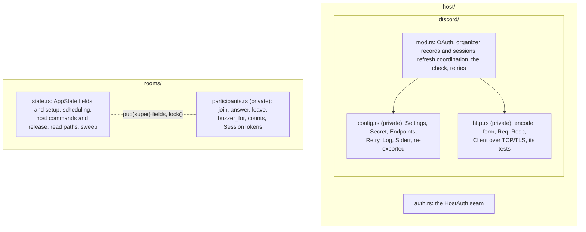

# ADR-0005: Separate the live room's responsibilities, keep one state owner

**Status:** Proposed (Michelle accepts or declines; a one-line commit flips it to Accepted before merge)
**Date:** 2026-10-12
**Deciders:** Michelle wrote the plan and the proposed MADR (Lattice PQ-71); Claude carried them out and chose the file-level details recorded here
**Contract:** none changed. Routes, payloads, error strings and their order, lock scopes and their order, public paths and method signatures are untouched. G-3, G-9, G-10, AC-61, AC-65, AC-66, AC-68, AC-69 hold as before.

Refines [ADR-0002](0002-group-the-room-source-by-who-uses-it.md) (group the room source by who uses it) one level down, inside `host/` and `rooms/`. Touches one [ADR-0004](0004-guardrail-scans-walk-the-tree.md) scan. Supersedes nothing.

## Context

After ADR-0002 the room's source was grouped by user, but two files still
mixed concerns:

| File | Lines on `main` | Mixed together |
|---|---|---|
| `host/discord.rs` | 1,019 | configuration and secrets, an HTTP/1.1 client over TCP or TLS, percent encoding, and the OAuth, session, refresh and authorization logic |
| `rooms/state.rs` | 486 | the state and its setup, scheduling, host commands and release, read paths, the sweep, and every participant operation and the socket's token map |

A change to sign-in meant reading past a TLS client. A change to joining
meant reading past release. Each pair has its own reason to change, but the
placement made changes harder to find and to review.

## Decision

Pull out cohesive **private** modules, and leave state ownership, locks and
execution exactly as they were.

- **Discord.** `discord/mod.rs` keeps everything whose order and concurrency
  rules are linked: OAuth sign-in, organizer records and sessions, refresh
  coordination, the authorization check, and the retry loop. Configuration
  goes to `config.rs`. Its six public types keep their paths
  (`room::discord::Settings`) through `pub use`. The transport goes to
  `http.rs`, with its three unit tests. Only what the parent calls is
  `pub(super)`. `http.rs` knows nothing about organizers or sessions: it
  encodes, sends what it is handed and returns a status and a body. The
  Discord payload shapes (`Member`, `Tokens`, `User`, `OAuthError`) stay with
  the check that reads them, because `Member` is AC-65's subject.
- **Module file.** Every directory module in `room/src` uses `mod.rs`, so the
  Discord module is `host/discord/mod.rs`, not `host/discord.rs` beside a
  folder.
- **Participants.** `rooms/participants.rs` holds `AppState::join`, `answer`,
  `leave`, `buzzer_for`, `session_count`, `set_live_counts` and
  `impl ws::SessionTokens for AppState`. It reaches the state through the
  `pub(super)` fields and `lock` helper that `rooms/` siblings already share.
  It adds no field, forwarding method, trait or service.
- **Moves are moves.** Every moved body and test is byte-identical apart from
  import lines and the visibility the move forces (`Secret::expose` and
  `matches`, and the transport items the parent calls, go from private to
  `pub(super)`). Each lock site in each moved function is the same, in the
  same order.
- **Invariants beside their code.** Six comments mark what the split must not
  break:
  - a session change and its live counts share one `rooms` lock;
  - release, session clearing, the used record and take-it-home are one step;
  - `questions` is locked before `rooms`;
  - the host check runs before anything is said about a room's end;
  - Discord refreshes are serialized and survive a dropped caller;
  - `Secret` stays inside `host::discord`, and the buzzer payload carries only
    its own session's answer before reveal.
- **Navigation.** `rooms/mod.rs` maps its files and traces the five main
  operations. `host/mod.rs` separates the organizer session (it may create a
  room) from the room-host session (it controls one room).

## Options Considered

### Option A: Extract cohesive private modules, keep the one state (chosen)

| Dimension | Assessment |
|---|---|
| Complexity | Low: moves, re-exports, `pub(super)` |
| Risk | Low: same locks, same bodies, the same 287 tests |
| Reviewability | High: each commit moves one concern, and a move is checkable line for line |

**Pros:** each concern has a file named for it. Callers do not change.
Critical transitions stay together and visible.
**Cons:** `AppState`'s methods now span files. Siblings still share
`pub(super)` internals.

### Option B: Documentation only

Minimal risk, but configuration, transport and authorization stay in one
1,019-line file. **Rejected.** A map does not create a boundary.

### Option C: Service and repository layers

Explicit interfaces, but traits, forwarding and wiring with no persistence
requirement behind them, and more indirection to follow an operation.
**Rejected** for this change.

### Option D: One async actor per room

One owner per room, but mailbox capacity, backpressure, cancellation,
replies and shutdown all need designing, and routes and sockets would
change. There is no measured contention to justify it. **Rejected.** An
actor change needs its own ADR.

### Option E: One file per operation

Easy to find by filename, but checks, helpers and invariants would scatter
across tightly coupled fragments. **Rejected.**

## Trade-off Analysis

The split is paid for in `pub(super)` keywords and one more file to open
when a request crosses config, transport and authorization. It buys
reviewability: a sign-in change no longer sits in a diff beside a TLS
client, and a join change no longer sits beside release. Keeping state
ownership and locks unchanged means the existing behavioural tests prove the
same things they proved before.

## Consequences

**Benefits**

| Before | After |
|---|---|
| `host/discord.rs` 1,019 lines | `discord/mod.rs` ~620, `config.rs` ~110, `http.rs` ~320 |
| `rooms/state.rs` 486 lines | `state.rs` ~340, `participants.rs` ~160 |
| Find the HTTP client: read the Discord backend | `host/discord/http.rs` |
| Find what a join does: search `state.rs` | `rooms/participants.rs` |
| Invariants implied by code | Named in comments beside the code |

**Harder / accepted**
- `AppState` is `impl`'d in `state.rs`, `create.rs` and `participants.rs`.
- Lock contention on the one `rooms` lock is unchanged. This ADR does not
  touch scalability.
- **The ADR-0004 scan.** `tests/auth.rs`'s AC-65 scan read
  `host/discord.rs` by name. It now walks every file in `host/discord/`. It
  requires `mod.rs`, `config.rs` and `http.rs` to be found, exactly one
  `struct Member`, that struct's fields to be `roles` alone, and no file to
  read `permissions`, ownership or a role name. That is the old assertion set
  plus two.
- Boundaries need discipline to stay put. The comments and the maps are the
  only guard.

**To revisit:** state ownership, when measured contention, persistence or
independently managed room tasks call for it. Module boundaries, when
routine changes keep crossing them, not when a file passes a line count.

## Action Items

1. [x] Rename `host/discord.rs` to `host/discord/mod.rs`; move the scan to a walk
2. [x] Split out `discord/config.rs` and `discord/http.rs`
3. [x] Split out `rooms/participants.rs`
4. [x] Module docs, the operation guide, the six invariant comments
5. [ ] Michelle accepts this ADR (Status → Accepted) before merge

## Where it lives

`room/src/host/discord/{mod,config,http}.rs` · `room/src/rooms/{state,participants}.rs` ·
`room/src/rooms/mod.rs` and `room/src/host/mod.rs` (the maps) · `room/README.md`
(*Source layout*) · `room/tests/auth.rs` (the AC-65 scan)
