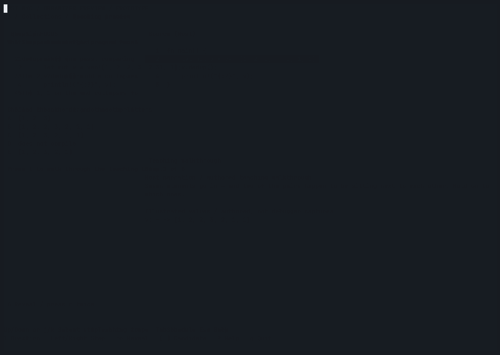
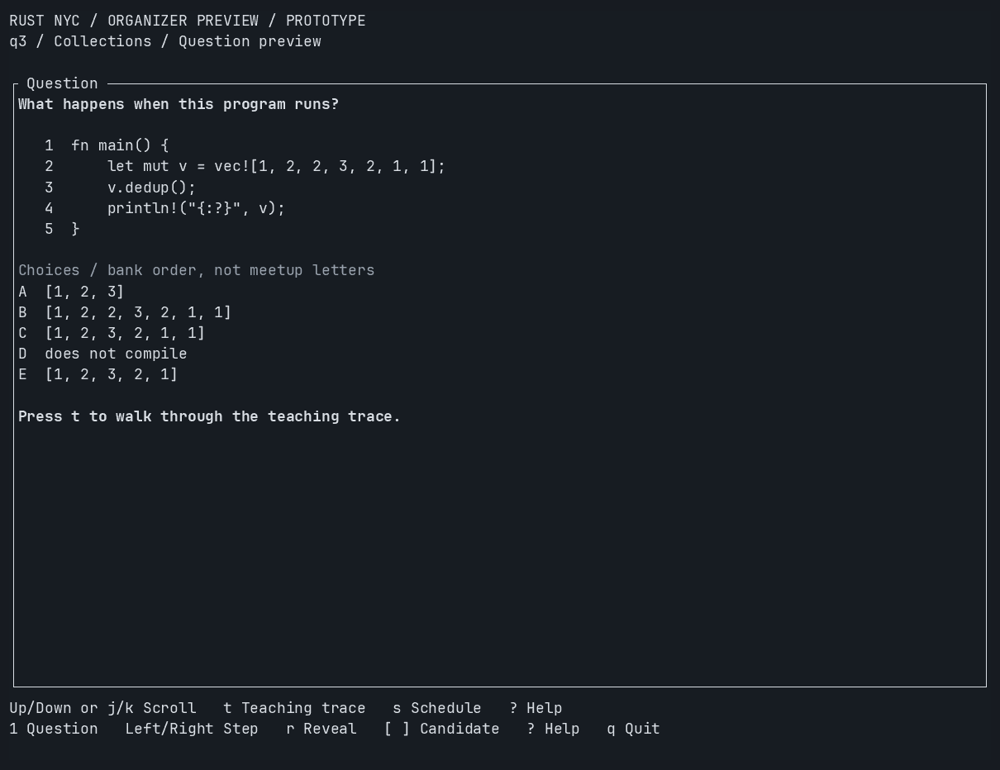

# Organizer preview

Preview a Rust quiz question and rehearse its teaching trace in the terminal.
Read the code and choices, step through the explanation, then reveal the answer.

The preview reads questions from the bank without changing them. Review
decisions and scheduling are explicit actions, each run through the pipeline.



The recording selects and opens a teaching step, moves keyboard focus between
panes, reveals the answer, and opens help. [Download the terminal recording](recordings/organizer-preview.cast)
to replay it with `asciinema play recordings/organizer-preview.cast`.

## Run

From the repository root:

```sh
cd prototypes/organizer-tui
cargo run --locked -- --question q3
```

The first build downloads dependencies. Use a terminal at least 40 columns wide
and 14 rows tall; 136 × 41 gives the code and narration more room. Below 80
columns, the focused pane fills the view. Tab switches panes.

To load another bank, add `--bank /path/to/bank`. That directory must contain a
`questions/` subdirectory with the question JSON files.

## Controls

| Key | Action |
| --- | --- |
| `1` | Show the question and five choices |
| `t` | Switch between the question and teaching trace |
| Tab | Move focus between steps, source, and narration |
| Enter | Open the selected teaching step |
| Left / Right or `<` / `>` | Step backward or forward |
| `r`, then Enter | Arm reveal, then show the answer and final trace step |
| `s` | Schedule the selected question |
| `v` | Review the selected question (shows the answer) |
| `[` / `]` | Open the previous or next question |
| Up / Down or `k` / `j` | Select a step, or scroll the focused pane |
| Page Up / Page Down | Move ten steps or scroll ten rows |
| Escape | Close help, return focus to steps, or go back to the question |
| `?` | Open or close keyboard help |
| `q` or Ctrl-C | Exit and restore the terminal |

Each trace step highlights the relevant code and shows the host's narration and
value changes. These steps are written as a teaching aid; the values are not
captured from a debugger.

The left list selects a step without changing the source or narration. Enter
opens that step. Left and Right step through the walkthrough immediately.
The focused pane has an amber border and a `FOCUS` label.

In the teaching trace, navigation stops before the final step. Press `r` to arm
reveal, then press Enter to see that step, the answer,
the explanation, why the other choices are tempting, and the verification receipt.
The first press shows “Press Enter to reveal the answer. Esc cancels.” Any
other key except repeated `r` disarms reveal. Repeated `r` never confirms. This safeguard also applies from the question preview.
Switching questions returns to the question view.

## Print a preview

Use `--snapshot` to print a screen without starting the interactive interface:

```sh
cargo run --locked -- --question q3 --snapshot question
cargo run --locked -- --question q3 --snapshot trace
cargo run --locked -- --question q3 --snapshot reveal
```

## Schedule a question

Press `s`, then enter the meetup date (`YYYY-MM-DD`), room server URL, and an
absolute directory outside this repository for the fallback deck and host sheet.
Use Tab or Up/Down to move between fields and Backspace to edit. Left/Right
are ignored in the form. Ctrl/Alt shortcuts are ignored except Ctrl-C to quit.
Enter opens a confirmation
screen; `y` sends the request. Escape cancels the form or returns to editing.
Use a terminal at least 110 × 36 for the full confirmation and result.
Page Up/Down scroll the form, confirmation, or result when space is limited.

The scheduler needs the pipeline's Python 3.12 environment at
`pipeline/.venv/bin/python`. Set `POPQUIZ_PYTHON` to an absolute executable path
to use another prepared environment. Export `POPQUIZ_ADMIN_TOKEN` in the terminal
before launching; the form never asks for it or puts it in command arguments.
See [pipeline setup and scheduling](../../pipeline/README.md).

Scheduling reloads the record and refuses an unverified, unaccepted, unaffirmed,
or previously used question. The result includes the scheduler's refusal or the
server's acknowledgement and generated file paths. The date determines option
order through the existing scheduler. A successful request may replace an
existing scheduled record and fallback files; the confirmation says so.

While a request runs, wait for the result. Closing the terminal does not undo a
submitted request. If the result says the room holds the record but fallback
writing failed, resolve that file problem before resubmitting. Scheduling does
not start a room or mark a question used. The TUI does not sync the used ledger.



This recording uses a temporary bank and test server, not a live meetup.

## Review a question

Press `v`. The first screen warns that review shows the answer; Enter continues.
The review screen shows the record's status, affirmation, difficulty, any
near-duplicate, the source, the choices with the machine-derived answer, the
explanation and hint with any trope warnings beside them, the receipt, quoted
output checks, and what blocks accepting or affirming. States are written out
in words.

| Key | Decision |
| --- | --- |
| `a` | Accept. Quoted text that is not a printed line is listed; `y` records that you checked it |
| `x` | Reject. Type a reason, then Enter |
| `d`, then `1`–`5` | Record the difficulty you judged |
| `e` | Edit in `$VISUAL` or `$EDITOR`. There is no default editor |
| `A` | Affirm, as the name in `POPQUIZ_ORGANIZER`. Without it the affirmation is refused |
| `j` / `k`, Page Up / Page Down | Scroll |
| Escape | Cancel, or close review |

Every decision waits for `y`. The screen runs `python -m popquiz.review`
([pipeline review](../../pipeline/README.md#reviewing)), which writes the
record; the TUI writes no file. An edit clears any affirmation, and a source or
choice change re-verifies with the pinned rustc and Miri, which can take
minutes. If the verifier rejects an edit, the bank is unchanged and the result
says where your edit file is kept. Closing review reloads the preview.

## Current limits

The [generation plan](docs/GENERATION_PLAN.md) covers offline batches, verification,
duplicate checks, and opening new candidates in this preview.

This prototype previews, reviews and schedules existing questions. Generation,
editing the trace's structure, and projector preview are not implemented. The
review screen is plain text.

Choices appear in bank order. Their letters can differ from the meetup's
date-based order. The preview does not check whether a question has already been
used; `q3` is included here as a demo.

Answers and receipts come from the saved verification records. Opening a question
does not run rustc or Miri. Older records identify Miri checks run outside the
verifier.

Long source lines wrap, and syntax highlighting is not implemented. Check
legibility in the actual projector view before using a question at a meetup.

## Development

The preview uses Ratatui 0.30.2 and Crossterm. It shares answer derivation and
receipt rendering with the `room` crate. Snapshots and rendering tests use
Ratatui's `TestBackend`.

From the repository root, `just test-organizer` runs the tests, Clippy, and
formatting checks. It is included in `just test` and CI; `just setup` fetches its
locked dependencies. Tests exercise terminal key events as well as app actions. The recipe also runs
stdlib-only Python PTY regressions on macOS/Linux for both legacy repeat bytes
and enhanced keyboard events, including protocol restoration.

```sh
cargo test --locked
cargo clippy --locked --all-targets -- -D warnings
cargo fmt --check
```

See [VALIDATION.md](docs/VALIDATION.md) for test results. This Cargo package is built
separately from the live room and is not included in its deployment.
